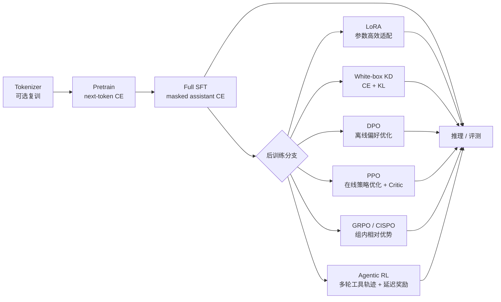

# MiniMind-3 / MiniMind-3-MoE 全流程训练解析

> 代码基线：`233d00f`（当前工作区 `master`）
>
> 分析范围：Tokenizer、预训练、全参 SFT、LoRA、知识蒸馏、DPO、PPO、GRPO/CISPO、Agentic RL，以及 `minimind-3` 与 `minimind-3-moe` 的模型结构。
>
> 阅读前提：了解 Python、PyTorch、概率论和 Transformer 基础。本文不逐行解释语法，而是把代码映射到数据、算法和训练决策。

## 0. 结论先行

MiniMind-3 的主线并不只是一个“训练脚本”，而是一条由数据格式、chat template、模型结构和多阶段目标函数共同组成的流水线：



需要先区分两类路线：

1. **必需主线**：`Tokenizer -> Pretrain -> Full SFT -> 评测/推理`。
2. **可选后训练**：LoRA、蒸馏、DPO、PPO、GRPO/CISPO、Agentic RL。它们不是必须全部串行执行的流水线，而是围绕 SFT 基座的不同优化方向。

README 推荐的主线组合是：

- 完整复现：`pretrain_t2t.jsonl + sft_t2t.jsonl + rlaif/agent_rl`。
- 低成本快速复现：`pretrain_t2t_mini.jsonl + sft_t2t_mini.jsonl`。
- Tool Calling 已经混入 `sft_t2t[_mini]`，当前不再需要单独的 Tool Calling SFT。
- “是否输出思考”由 chat template 的 `open_thinking` 控制，不再单独训练一个 reasoning 模型。

## 1. 代码、文档与数据的事实边界

本文事实来源分为三层：

| 来源 | 用来确认什么 | 主要位置 |
|---|---|---|
| 模型代码 | 网络结构、前向计算、损失、生成逻辑 | `model/model_minimind.py` |
| 训练代码 | 参数默认值、优化器、训练循环、数据消费方式 | `trainer/*.py` |
| 数据与 README | 数据集来源、用途、大小、推荐组合 | `README.md`、`dataset/dataset.md` |

当前仓库没有包含实际的训练 JSONL 文件，因此：

- 数据来源、文件大小和推荐 `max_seq_len` 来自 README。
- 数据字段和预处理行为来自 `dataset/lm_dataset.py`。
- 本文不声称重新统计了未下载数据的样本数、token 数或真实分布。

---

## 2. 数据体系

### 2.1 数据总表

README 列出的主线数据位于 `dataset/`，可按需单独下载：

| 文件 | 大小 | 阶段 | 作用 |
|---|---:|---|---|
| `pretrain_t2t_mini.jsonl` | 1.2 GB | Pretrain | 快速复现，推荐 `max_seq_len` 约 768 |
| `pretrain_t2t.jsonl` | 10 GB | Pretrain | 完整主线预训练，推荐 `max_seq_len` 约 380 |
| `sft_t2t_mini.jsonl` | 1.6 GB | SFT | 快速训练 Zero 对话模型，已混入 Tool Call |
| `sft_t2t.jsonl` | 14 GB | SFT | 完整主线 SFT，已混入 Tool Call |
| `rlaif.jsonl` | 24 MB | RLAIF | PPO / GRPO / CISPO 的 prompt 数据 |
| `dpo.jsonl` | 53 MB | RLHF | 静态 chosen/rejected 偏好对 |
| `agent_rl.jsonl` | 86 MB | Agentic RL | 多轮工具调用、GT 校验与轨迹奖励 |
| `agent_rl_math.jsonl` | 18 MB | Agentic RL | 偏数学/推理的补充轨迹数据 |

下载地址：[ModelScope](https://www.modelscope.cn/datasets/gongjy/minimind_dataset/files) 或 [HuggingFace](https://huggingface.co/datasets/jingyaogong/minimind_dataset/tree/main)。

### 2.2 预训练数据

代码期望的 JSONL 格式：

```jsonl
{"text": "如何才能摆脱拖延症？治愈拖延症并不容易，但以下建议可能有所帮助。"}
{"text": "清晨的阳光透过窗帘洒进房间，桌上的书页被风轻轻吹动。"}
{"text": "Transformer 通过自注意力机制建模上下文关系，是现代大语言模型的重要基础结构。"}
```

README 描述的数据来源包括通用文本语料、对话整理语料、蒸馏补充语料和宽松开源协议可用的公开数据集，主要来源包括：

- [匠数大模型数据集 / DeepCtrl SFT](https://www.modelscope.cn/datasets/deepctrl/deepctrl-sft-data)
- [Magpie-Align](https://www.modelscope.cn/organization/Magpie-Align)
- 其他经过清洗、去重、长度控制和格式统一的公开语料

`PretrainDataset` 的处理顺序见 `dataset/lm_dataset.py:PretrainDataset`：

1. 读取 `text`。
2. 用 tokenizer 编码，并截断到 `max_length - 2`。
3. 首尾加入 `bos_token` 与 `eos_token`。
4. 用 `pad_token_id` 补齐到固定长度。
5. 标签复制输入，所有 padding 位置改为 `-100`。
6. 模型内部把 `logits[..., :-1, :]` 与 `labels[..., 1:]` 对齐，执行 next-token cross-entropy。

因此这是一个标准的 decoder-only 自回归语言建模样本，不是“输入一句话、输出一句固定答案”的监督样本。

### 2.3 SFT 数据

SFT 使用多轮会话 JSONL：

```jsonl
{
  "conversations": [
    {"role": "system", "content": "You are a helpful AI assistant."},
    {"role": "user", "content": "你好"},
    {"role": "assistant", "content": "你好！有什么可以帮你？"}
  ]
}
```

带 Tool Call 的样本遵循 OpenAI 风格消息结构：

```jsonl
{
  "conversations": [
    {
      "role": "system",
      "content": "# Tools ...",
      "tools": "[{\"type\":\"function\",\"function\":{\"name\":\"calculate_math\"}}]"
    },
    {"role": "user", "content": "帮我算一下 256 乘以 37 等于多少"},
    {
      "role": "assistant",
      "content": "",
      "tool_calls": "[{\"name\":\"calculate_math\",\"arguments\":{\"expression\":\"256 * 37\"}}]"
    },
    {"role": "tool", "content": "{\"result\":\"9472\"}"},
    {"role": "assistant", "content": "256 乘以 37 等于 9472。"}
  ]
}
```

`SFTDataset` 会：

- 从 system 消息中解析 `tools`。
- 从 assistant 消息中解析 `tool_calls`。
- 调用 tokenizer 的 `apply_chat_template` 展开 `system/user/assistant/tool` 消息。
- 通过 `<|im_start|>assistant\n` 与 `<|im_end|>\n` 定位 assistant 片段。
- 只对 assistant 片段计算语言模型损失，user、system、tool 和 padding 位置均被 mask 为 `-100`。
- 以 20% 概率为原本无 system 的普通对话加入随机 system prompt。
- 以 80% 概率移除空思考标签 `<think>\n\n</think>\n\n`，保留少量空思考形式以增强鲁棒性。

SFT 数据来源包括高质量指令跟随数据、公开对话、模型蒸馏合成数据，以及协议友好的公开数据集。README 点名的主要来源有：

- [DeepCtrl SFT](https://www.modelscope.cn/datasets/deepctrl/deepctrl-sft-data)
- [Magpie-Align](https://www.modelscope.cn/organization/Magpie-Align)
- [R1-Distill-SFT](https://www.modelscope.cn/datasets/AI-ModelScope/R1-Distill-SFT)
- [COIG](https://huggingface.co/datasets/BAAI/COIG)
- [Step-3.5-Flash-SFT](https://huggingface.co/datasets/stepfun-ai/Step-3.5-Flash-SFT)

此外，README 说明当前 Tool Call 数据中约有 10 万条由 `qwen3-4b` 合成，主要覆盖约 10 个模拟工具；这些工具样本提供的是基础格式与调用能力，不宣称具备广泛工具泛化能力。

### 2.4 DPO 数据

`dpo.jsonl` 的每条样本包含同一问题下的两条完整会话：

```json
{
  "chosen": [
    {"role": "user", "content": "Q"},
    {"role": "assistant", "content": "good answer"}
  ],
  "rejected": [
    {"role": "user", "content": "Q"},
    {"role": "assistant", "content": "bad answer"}
  ]
}
```

README 说明它抽样自 [DPO-En-Zh-20k](https://huggingface.co/datasets/llamafactory/DPO-En-Zh-20k)。`DPODataset` 分别对 chosen 与 rejected 应用 chat template、截断/补齐并生成 assistant-only loss mask，再把两条序列拼接成一个 batch。训练器依赖 batch 前半部分为 chosen、后半部分为 rejected 来构造成对损失。

### 2.5 RLAIF 与 Agent RL 数据

RLAIF prompt 数据沿用 SFT 的 `conversations` 格式，但训练时只保留最后一条 assistant 回答之前的内容，作为待续写 prompt：

- `RLAIFDataset.create_chat_prompt()` 丢弃最后一条 assistant 消息。
- 通过 `open_thinking` 以 `thinking_ratio` 的概率决定是否预先注入 ` think\n`。
- 参考答案不直接参与 policy loss；奖励由 Reward Model 与规则项计算。

Agent RL 数据额外包含：

```json
{
  "conversations": [
    {"role": "system", "content": "...", "tools": "[...]"},
    {"role": "user", "content": "..."}
  ],
  "gt": ["最终答案或需被文本验证的目标值"]
}
```

`AgentRLDataset` 解析消息和工具定义，丢弃最后一条 assistant，保留 `messages`、`tools`、`gt`。正式轨迹由训练时的多轮 rollout 生成，而不是直接把数据中的 assistant 文本当作监督目标。

### 2.6 Tokenizer

自带 tokenizer 是 ByteLevel BPE：

| 属性 | 值 |
|---|---|
| 词表大小 | 6,400 |
| BPE merges | 6,108 |
| special / added tokens | 36 |
| `bos_token` | `<|im_start|>` |
| `eos_token` | `<|im_end|>` |
| `pad_token` / `unk_token` | `<|endoftext|>` |
| 特殊能力 token | `<tool_call>`、`</tool_call>`、`<tool_response>`、`</tool_response>`、` think`、`</think>` 等 |

`trainer/train_tokenizer.py` 提供从零训练 BPE 的参考实现，但 README 明确不建议重训：词表或切分规则一变，现有权重、数据格式、推理接口和生态兼容性都会失效。对 64M 级模型来说，6,400 词表还能显著降低 embedding 与输出层的参数占比。

Chat template 负责把结构化消息转为文本协议，包括：

```text
<|im_start|>system
...
<|im_end|>
<|im_start|>user
...
<|im_end|>
<|im_start|>assistant
 think
...
</think>

...
<|im_end|>
```

Tool Call 被渲染为 `<tool_call>{...}</tool_call>`，工具结果被渲染为 `<tool_response>...</tool_response>`。因此，Tool Calling 的主要学习载体是 SFT 数据和 tokenizer/template，而不是额外的一个网络模块。

---

## 3. MiniMind-3 与 MiniMind-3-MoE 模型结构

### 3.1 默认配置

两个模型共享同一套主干配置，差异只在每个 Transformer Block 的 FFN：

| 参数 | Dense (`minimind-3`) | MoE (`minimind-3-moe`) |
|---|---:|---:|
| `hidden_size` / `d_model` | 768 | 768 |
| `num_hidden_layers` | 8 | 8 |
| `vocab_size` | 6,400 | 6,400 |
| attention heads | 8 | 8 |
| KV heads | 4 | 4 |
| `head_dim` | 96 | 96 |
| FFN intermediate size | 2,432 | 每个专家 2,432 |
| experts | - | 4 |
| top-k experts / token | - | 1 |
| shared expert | - | 无 |
| `max_position_embeddings` | 32,768 | 32,768 |
| `rope_theta` | 1,000,000 | 1,000,000 |
| RMSNorm epsilon | `1e-6` | `1e-6` |
| dropout | 0 | 0 |
| tied embeddings | 是 | 是 |
| router aux loss 系数 | - | `5e-4` |

配置定义见 `model/model_minimind.py:MiniMindConfig`。FFN 宽度由下式生成：

$$
d_{ff}=\left\lceil\frac{d_{model}\pi}{64}\right\rceil 64
=\left\lceil\frac{768\pi}{64}\right\rceil 64=2,432
$$

### 3.2 整体数据流

```text
input_ids
  -> token embedding
  -> N x MiniMindBlock
       x = x + Attention(RMSNorm(x))
       x = x + FFN_or_MoE(RMSNorm(x))
  -> final RMSNorm
  -> lm_head
  -> next-token logits
```

对应实现：

- `MiniMindModel.forward()`：embedding、RoPE buffer、逐层前向、最终 norm。
- `MiniMindBlock.forward()`：Pre-Norm 残差结构。
- `MiniMindForCausalLM.forward()`：LM head、shifted CE、可选 KV cache。
- `MiniMindForCausalLM.generate()`：采样、top-k、top-p、重复惩罚和 KV cache 解码。

### 3.3 Attention：GQA + QK-Norm + RoPE

`Attention` 的投影关系如下：

$$
Q=XW_q,\quad K=XW_k,\quad V=XW_v,\quad O=\operatorname{concat}(A_1,\ldots,A_8)W_o
$$

其中：

- 8 个 query heads。
- 4 个 key/value heads。
- 每个 head 的维度为 96。
- K/V 在 head 维上重复一次，供 2 个 query heads 共享。
- Q 和 K 分别经过 head-wise RMSNorm，再应用 RoPE。
- Q/K/V/O 全部无 bias。

注意力计算：

$$
A=\operatorname{softmax}\left(\frac{QK^\top}{\sqrt{d_h}}+M_{\text{causal}}\right),\qquad
\operatorname{head}=AV
$$

实现有两条路径：

1. 当没有 padding mask、`seq_len > 1` 且满足条件时，使用 PyTorch `scaled_dot_product_attention`。
2. 其他情况使用显式 score、causal mask、attention mask、softmax 和 dropout。

#### GQA 的作用

标准 MHA 中每个 query head 都有独立 K/V；GQA 让多个 query heads 共享 K/V，从而减少 KV cache 和 K/V 投影参数。这里 query:KV = 8:4，推理时每层缓存 4 个 KV heads，而不是 8 个。

#### RoPE 的作用

RoPE 对 Q、K 的二维子空间做旋转，使 attention 中内积自然携带相对位置信息。代码见：

- `precompute_freqs_cis()`：预计算 `cos/sin`。
- `apply_rotary_pos_emb()`：旋转 Q/K。
- `MiniMindModel.forward()`：按 `start_pos` 截取当前位置的 RoPE buffer。

#### YaRN 外推

默认 `inference_rope_scaling=False`。开启后使用：

- `original_max_position_embeddings=2048`
- `factor=16`
- `beta_fast=32`
- `beta_slow=1`
- `attention_factor=1.0`

频率按线性 ramp 从原始频率过渡到缩放频率。它解决的是位置频率随长度外推失真的问题，不是在训练阶段新增参数。

### 3.4 Dense FFN：SwiGLU

`FeedForward` 是 Qwen/LLaMA 风格的 gated MLP：

$$
\operatorname{FFN}(x)=W_{\text{down}}\left(\operatorname{SiLU}(W_{\text{gate}}x)\odot W_{\text{up}}x\right)
$$

三个线性层：

- `gate_proj`: `768 -> 2432`
- `up_proj`: `768 -> 2432`
- `down_proj`: `2432 -> 768`

SwiGLU 比单路 ReLU/GELU MLP 多一个 gate 分支，用乘积做特征门控；在相同目标维度下通常有更好的表达效率，但参数和计算量也更高。

### 3.5 MoE FFN：4 experts / top-1，无 shared expert

MoE 版本把 Dense FFN 替换为 `MOEFeedForward`：

1. Router 把每个 token 的 768 维隐状态映射为 4 个专家分数。
2. 对分数做 softmax。
3. 选择 top-1 专家。
4. 将 token 送入对应专家。
5. 按路由权重聚合专家输出。

形式化地：

$$
s=\operatorname{softmax}(W_r x),\qquad
k=\operatorname{arg\,top1}(s),\qquad
y=s_kE_k(x)
$$

当前配置下，`top1_weight` 使用 straight-through 写法：

```python
top1 = softmax(gate(x.detach())).topk(1)
weight = top1 - top1.detach() + 1.0
```

前向值为 1.0，反向保留 router 梯度。这使 top-1 专家输出不被路由概率缩小，同时 router 仍能收到梯度。

#### 负载均衡辅助损失

`MOEFeedForward.forward()` 计算：

$$
\mathcal{L}_{aux}
=\alpha N\sum_{i=1}^{N}\bar{f_i}\bar{s_i}
$$

其中：

- $\bar{f_i}$ 是 top-k 分配中第 $i$ 个专家的平均负载。
- $\bar{s_i}$ 是 router 对该专家的平均概率。
- $N=4$。
- $\alpha=5\times10^{-4}$。

该损失鼓励 token 分布更均匀，防止少数专家被“饿死”。

#### 为什么不用 shared expert

README 明确说明当前主线移除了 shared expert，以保持原生 PyTorch 实现简单，并与当前 Qwen3-MoE 风格配置对齐。代价是每个 token 完全依赖路由专家；收益是结构更直接、参数统计更清晰。

#### 训练时的未使用专家处理

代码对没有被任何 token 选中的专家执行一个零梯度前向：

```python
y[0, 0] += 0 * sum(p.sum() for p in expert.parameters())
```

这不是算法的一部分，而是为了在 DDP 训练中让所有专家参数参与计算图，避免“未使用参数”导致的通信或梯度错误。

### 3.6 参数量推导

以 tied embedding 只计一次、无 bias、`head_dim=96`、`d_ff=2432` 计算。

每个 Block 的 attention 与 norm 参数：

- Q: $768\times768=589,824$
- K: $768\times384=294,912$
- V: $768\times384=294,912$
- O: $768\times768=589,824$
- Q/K RMSNorm: $96+96=192$
- 两个 768 维 RMSNorm: $768+768=1,536$
- 合计：$1,771,200$

Dense 每个专家/FFN：

- gate/up/down: $3\times768\times2432=5,603,328$

因此：

| 项目 | 参数量 |
|---|---:|
| Dense Block | $1,771,200+5,603,328=7,374,528$ |
| Dense 8 层 | $58,996,224$ |
| embedding（也作为 LM head） | $6,400\times768=4,915,200$ |
| final RMSNorm | $768$ |
| **Dense 合计** | **63,912,192 ≈ 63.91M** |
| MoE 每层 | attention/norm + gate + 4 experts = $24,187,584$ |
| MoE 8 层 | $193,500,672$ |
| embedding + final norm | $4,915,968$ |
| **MoE 总参数** | **198,416,640 ≈ 198.42M** |
| **MoE 单 token 激活参数** | **63,936,768 ≈ 63.94M** |

这解释了发布表中的 `198M-A64M`：MoE 的存储/总参数约为 Dense 的 3.1 倍，但一次前向只激活 1 个专家，激活量仅比 Dense 略高。

### 3.7 结构设计上的工程取舍

- 8 层 × 768 维是浅而较宽的结构，优先降低训练时间，同时避免宽度小于 512 后 head_dim 过小带来的表达劣势。
- 8 个 query heads + 4 个 KV heads 是小模型中较平衡的 GQA 配置。
- tied embedding 显著减少 6400 词表带来的输入/输出参数。
- MoE 用更高总容量换更低激活成本；但在原生逐专家 PyTorch 循环下，实际训练速度未必比 Dense 快，README 估计约慢 50%。
- `flash_attn=True` 并不是外部 FlashAttention 包，而是启用 PyTorch 自带的 `scaled_dot_product_attention` 路径。

### 3.8 生成逻辑

`MiniMindForCausalLM.generate()` 支持：

- temperature 缩放。
- top-k 过滤。
- nucleus/top-p 过滤。
- repetition penalty。
- EOS 后停止。
- KV cache。
- streamer 与多返回序列。

它主要用于教学、评测和本地小模型推理，不等同于工业级推理引擎。大规模 rollout 时可切换到 SGLang。

---

## 4. 算法与理论基础

### 4.1 预训练：Next-Token Cross-Entropy

对长度为 $T$ 的 token 序列，模型在第 $t$ 个位置给出下一 token 分布：

$$
p_\theta(x_{t+1}\mid x_{\le t})
$$

预训练目标：

$$
\mathcal{L}_{PT}
=-\frac{1}{T-1}\sum_{t=1}^{T-1}
\log p_\theta(x_{t+1}\mid x_{\le t})
$$

代码实现：

- `MiniMindForCausalLM.forward()` 中执行 logits 与 labels 的 shift。
- `ignore_index=-100` 排除 padding。
- MoE 时训练器额外加上 `aux_loss`。

理论直觉：模型通过“预测下一个 token”学习词法、句法、事实共现、长程依赖和一定程度的推理模式。它是自监督目标，不需要人工逐 token 标注。

### 4.2 SFT：Assistant-only Masked CE

SFT 仍使用交叉熵，但只在 assistant 输出 token 上计算：

$$
\mathcal{L}_{SFT}
=-\sum_{t\in\mathcal{A}}
\log p_\theta(y_t\mid \text{system},\text{user},y_{<t})
$$

其中 $\mathcal{A}$ 是 assistant span 的 token 集合。代码通过定位 `<|im_start|>assistant\n` 和 `<|im_end|>\n` 构造 mask。这样模型会学习：

- 如何遵循指令。
- 如何组织答案。
- 多轮对话和工具消息格式。
- ` thinking` 标签内的显式思考格式。

而不是去预测用户问题本身。

### 4.3 LoRA：低秩增量适配

对冻结的原权重 $W_0\in\mathbb{R}^{d_{out}\times d_{in}}$，LoRA 学习：

$$
W'=W_0+\Delta W,\qquad \Delta W=BA
$$

其中：

$$
A\in\mathbb{R}^{r\times d_{in}},\qquad B\in\mathbb{R}^{d_{out}\times r}
$$

前向为：

$$
h=W_0x+BAx
$$

本仓库配置：

- rank $r=16$。
- `A` 服从均值 0、标准差 0.02 的高斯初始化。
- `B` 初始化为 0，因此训练开始时旁路输出为 0。
- 原模型参数冻结，只训练 LoRA 参数。
- 未实现常见的 `alpha/r` 缩放项。

实现边界：`apply_lora()` 只给 `in_features == out_features` 的 `nn.Linear` 增加旁路。在当前结构中，最明显的是 attention 的 Q/O 方形投影；K/V 投影和 FFN 投影不是方形，因此不会自动获得 LoRA。这是理解本仓库 LoRA 时必须单独说明的点，不能等同于“对所有线性层都加 LoRA”。

### 4.4 白盒知识蒸馏：CE + KL

教师与学生使用同一输入和 labels。教师先在 `eval()`、`no_grad()` 下产生 logits：

$$
p_t^T=\operatorname{softmax}(z_t/T),\qquad
p_s^T=\operatorname{softmax}(z_s/T)
$$

总损失：

$$
\mathcal{L}_{KD}
=\alpha\mathcal{L}_{CE}
+(1-\alpha)T^2\operatorname{KL}(p_t^T\parallel p_s^T)
$$

代码默认：

- $\alpha=0.5$。
- $T=1.5$。
- 学生默认 Dense 768×8。
- 教师默认 MoE 768×8。
- 两者都默认从 `full_sft` 权重加载。
- 教师 logits 若词表更大，会被截断到学生词表大小。

$T^2$ 用于补偿温度缩放后 softened distribution 的梯度尺度变化，使不同温度下的 KL 项量级更可比。

黑盒蒸馏则只用教师生成的文本作为硬标签，本质上仍是 SFT：

$$
\mathcal{L}_{blackbox}=\operatorname{CE}(y_{teacher},p_{student})
$$

当前 SFT 数据中的模型生成答案、工具调用样本和推理数据，很多都可以视为广义黑盒蒸馏信号。

### 4.5 DPO：离线偏好优化

DPO 直接使用静态 chosen/rejected 对，不训练单独的 Reward Model。设：

$$
\pi_w=\pi_\theta(y_w\mid x),\qquad
\pi_l=\pi_\theta(y_l\mid x)
$$

以及参考策略 $\pi_{ref}$。定义对数比：

$$
\Delta_\theta
=\log\frac{\pi_\theta(y_w\mid x)}{\pi_\theta(y_l\mid x)}
-\log\frac{\pi_{ref}(y_w\mid x)}{\pi_{ref}(y_l\mid x)}
$$

DPO 损失：

$$
\mathcal{L}_{DPO}
=-\log\sigma(\beta\Delta_\theta)
$$

其中：

- $y_w$ 是 chosen。
- $y_l$ 是 rejected。
- $\beta=0.15$ 控制偏离参考策略的强度。
- 参考模型是冻结的 `full_sft` 副本。
- 损失只聚合 assistant mask 范围内的 token log-prob。

DPO 的优点是不需要在线采样和 Reward Model，缺点是优化的是静态偏好对，无法探索当前策略新生成的高价值回答。

### 4.6 PPO：在线策略优化

PPO 同时维护 Actor 和 Critic。Actor 负责生成回答，Critic 从同一基座初始化并增加 `value_head: hidden_size -> 1`，估计每个 token 状态的价值。

#### Rollout 与奖励

- 每个 prompt 生成 1 条回答。
- 采样温度为 0.8。
- 外部奖励只加在回答最后一个有效 token 上。
- Reward Model 分数被限制在 $[-3,3]$。
- 另加回答长度、思考长度、`</think>` 唯一性和重复 n-gram 惩罚。

#### GAE 与优势

价值与回报：

$$
\delta_t=r_t+\gamma V(s_{t+1})-V(s_t)
$$

$$
\hat{A}_t=\delta_t+\gamma\lambda\delta_{t+1}+\cdots
$$

$$
\hat{R}_t=\hat{A}_t+V(s_t)
$$

代码默认：

- $\gamma=1.0$，表示回答内部不额外折扣。
- $\lambda=0.95$。
- 优势在有效 response token 上做整体标准化。

#### PPO 策略损失

令：

$$
r_t(\theta)=\frac{\pi_\theta(o_t\mid s_t)}{\pi_{old}(o_t\mid s_t)}
=\exp\left(\log\pi_\theta-\log\pi_{old}\right)
$$

策略损失为：

$$
\mathcal{L}_{policy}
=-\mathbb{E}\left[
\min\left(r_tA_t,
\operatorname{clip}(r_t,1-\epsilon,1+\epsilon)A_t\right)
\right]
+\beta_{KL}\operatorname{KL}_{ref}
$$

代码默认 `clip_epsilon=0.2`、`kl_coef=0.02`。

#### Critic 损失

$$
\mathcal{L}_{value}
=\frac12\mathbb{E}\left[
\max\left(
(V_\theta(s_t)-\hat{R}_t)^2,
(\operatorname{clip}(V_\theta(s_t),V_{old}-\epsilon_v,V_{old}+\epsilon_v)-\hat{R}_t)^2
\right)
\right]
$$

默认 `vf_coef=0.5`、`cliprange_value=0.2`。

#### 同批数据复用与早停

- `ppo_update_iters=2`：同一 rollout batch 上做两轮 PPO 更新。
- `mini_batch_size=2`。
- 使用近似 KL 监测策略变化；超过 `early_stop_kl=0.25` 时停止后续 PPO 更新。
- 训练保存 actor 权重 `ppo_actor_768[_moe].pth`。

PPO 是 on-policy 方法：rollout 分布与当前策略相关，旧样本只能有限复用。它比 DPO 更接近传统策略梯度，但需要 Critic、Reward Model 和更高显存。

### 4.7 GRPO 与 CISPO：不训练 Critic 的组内相对优化

GRPO 对每个 prompt 生成 $G$ 个回答，在同一组内比较奖励：

$$
A_{i,j}
=\frac{R_{i,j}-\mu_i}
{\sigma_i+\epsilon}
$$

其中：

- $i$ 是 prompt 索引。
- $j$ 是该 prompt 的第 $j$ 个采样回答。
- $\mu_i,\sigma_i$ 是该组奖励的均值和总体标准差。
- 不需要 Critic。

GRPO 策略目标：

$$
\mathcal{L}_{GRPO}
=-\mathbb{E}\left[
\min\left(r_tA_t,\operatorname{clip}(r_t,1-\epsilon,1+\epsilon)A_t\right)
-\beta\operatorname{KL}_t
\right]
$$

代码中的 token KL 使用无偏形式：

$$
\operatorname{KL}_t
=\exp(\Delta_t)-\Delta_t-1,
\qquad
\Delta_t=\log\pi_{ref}(o_t)-\log\pi_\theta(o_t)
$$

默认 `num_generations=6`、`beta=0.1`、`epsilon=0.2`，loss 类型默认是 `cispo`。

CISPO 分支在当前代码中的核心是：

```python
clamped_ratio = torch.clamp(ratio, max=epsilon_high).detach()
per_token_loss = -(clamped_ratio * advantage * logp - beta * kl)
```

默认 `epsilon_high=5.0`。它将截断后的重要性比率作为前向权重，同时使用当前策略 log-prob 构造可微目标。解读时不要套用监督学习的“loss 越低越好”：这里优化的是策略目标的代理量，应该结合 reward、KL、组内奖励方差和实际生成质量判断。

GRPO/CISPO 的主要风险是退化组：如果同一 prompt 的多个回答奖励几乎相同，标准化后的优势接近 0，学习信号消失。MiniMind 通过 Reward Model 的连续分数、回答格式规则和长度区间惩罚来缓解稀疏奖励。

### 4.8 通用奖励规则

PPO、GRPO 和 Agent 的共同基础是 `calculate_rewards()`。普通单轮回答的规则分包括：

| 规则 | 奖励 |
|---|---:|
| 回答长度在 20 到 800 字符 | `+0.5` |
| 回答过短或过长 | `-0.5` |
| 有 `</think>` 且思考长度在 20 到 300 字符 | `+1.0` |
| 思考长度不符合要求 | `-0.5` |
| 恰好出现一次 `</think>` | `+0.25` |
| `</think>` 数量异常 | `-0.25` |
| 重复 3-gram | 每项最多扣 `0.5` |
| Reward Model 分数 | 原始连续分，整体受限到 `[-3,3]` |

默认 Reward Model 为 `InternLM2-1.8B-Reward`，放在项目同级目录 `internlm2-1_8b-reward/`。`LMForRewardModel` 会把对话历史和最后问题拼接成评分输入，并调用模型的 `get_score()`。

这些规则并不是“真值奖励”，而是工程上的稠密奖励塑形：小模型在开放问答中若只依赖 0/1 正确性，容易全部得 0 分，优势消失；连续 RM 分和格式分至少能提供可学习的相对差异。

### 4.9 Agentic RL：多轮工具轨迹与延迟奖励

`train_agent.py` 不是单轮文本 RL，而是：

```text
prompt
 -> model emits tool_call
 -> parse JSON
 -> execute mock tool
 -> append tool_response
 -> model continues
 -> ... up to 3 turns
 -> score complete trajectory
 -> policy update
```

当前内置 6 个模拟工具：

- `calculate_math`
- `unit_converter`
- `get_current_weather`
- `get_current_time`
- `get_exchange_rate`
- `translate_text`

工具执行使用固定模拟数据或安全数学求值。工具检查关注：

- 工具名是否在样本提供的工具列表中。
- 参数是否符合 `CHECK_ARGS` 规则。
- 调用数量与 `gt` 数量是否一致。
- `tool_call` 标签是否闭合。
- 最终文本是否包含所有 GT 值。
- 是否在最大轮数内完成。

轨迹奖励可以概括为：

$$
R(\tau)
=R_{format}+R_{tool}+R_{answer}+R_{RM}-R_{unfinished}-R_{repeat}
$$

当前规则的量级：

- 无效工具调用与期望调用数差异：`-0.5 * gap`。
- 工具数量和名称对齐：`+0.5`。
- 最终答案覆盖 GT：每个目标最多合计 `+2.5`。
- 未完成：`-0.5`。
- 最终总奖励裁剪到 `[-3,3]`。

训练时多轮工具 observation 被拼入上下文，但 observation token 的 policy mask 为 0；只有模型自己生成的 token 参与策略梯度。默认 `max_turns=3`、每 prompt `num_generations=4`、`max_gen_len=768`、`thinking_ratio=0.1`。

`rollout_engine` 支持两种模式：

- `torch`：本地模型直接生成，适合小规模训练和调试。
- `sglang`：训练侧与推理侧分离，通过共享 checkpoint 同步权重，适合提高 rollout 吞吐。

当前仍是同步 rollout：先采样一批轨迹，再训练，再更新推理权重，不是完全异步的工业级训练系统。

---

## 5. 完整训练步骤

### 5.1 训练前准备

所有训练脚本默认从 `trainer/` 目录执行：

```bash
cd trainer
```

所需数据放在仓库根目录的 `dataset/`。基础训练建议至少下载：

```text
dataset/pretrain_t2t_mini.jsonl
dataset/sft_t2t_mini.jsonl
```

完整复现时再准备：

```text
dataset/pretrain_t2t.jsonl
dataset/sft_t2t.jsonl
dataset/rlaif.jsonl
dataset/dpo.jsonl
dataset/agent_rl.jsonl
dataset/agent_rl_math.jsonl
```

默认设备选择规则是“有 CUDA 用 `cuda:0`，否则 CPU”；默认精度是 `bfloat16`。CPU、MPS 和多卡的实际兼容性需以环境中 PyTorch 和相关算子为准。

### 5.2 第 0 步：Tokenizer

主线直接使用 `model/tokenizer.json` 和 `model/tokenizer_config.json`。这一步通常不需要重新训练。

若要学习 BPE 流程，可运行：

```bash
cd trainer
python train_tokenizer.py
```

其参考常量见 `trainer/train_tokenizer.py`：

| 参数 | 值 |
|---|---:|
| 训练数据 | `../dataset/sft_t2t_mini.jsonl` |
| 词表大小 | 6,400 |
| special tokens 数 | 36 |
| BPE | ByteLevel |
| `add_prefix_space` | False |
| 最大读取行数 | 0，表示全部 |

注意：重训 tokenizer 会改变 token id 和切分边界，不能直接加载官方权重；本报告把重训定位为学习用途，而不是主线复现步骤。

### 5.3 第 1 步：预训练

Dense：

```bash
cd trainer
python train_pretrain.py
```

MoE：

```bash
cd trainer
python train_pretrain.py --use_moe 1
```

完整数据主线可按 README 调整：

```bash
python train_pretrain.py \
  --data_path ../dataset/pretrain_t2t.jsonl \
  --max_seq_len 380
```

对于 MoE 完整主线，再追加 `--use_moe 1`。

默认行为：

- 从随机初始化开始，`from_weight=none`。
- 使用 `pretrain_t2t_mini.jsonl`。
- 模型配置为 768 维、8 层。
- 输出 `out/pretrain_768.pth` 或 `out/pretrain_768_moe.pth`。
- 保存间隔默认 1000 step。
- 支持 `--from_resume 1` 从 `checkpoints/` 恢复模型、优化器和训练进度。

预训练结束后，模型应具备基础词语接龙和语言建模能力，但不一定稳定遵循指令。可用以下命令做中间检查：

```bash
python eval_llm.py --weight pretrain
```

MoE 检查时还需要匹配 `--use_moe 1`。

### 5.4 第 2 步：全参 SFT

Dense：

```bash
cd trainer
python train_full_sft.py
```

MoE：

```bash
cd trainer
python train_full_sft.py --use_moe 1
```

完整 SFT 数据：

```bash
python train_full_sft.py --data_path ../dataset/sft_t2t.jsonl
```

默认行为：

- 加载 `out/pretrain_768[_moe].pth`。
- 使用 `sft_t2t_mini.jsonl`。
- 只对 assistant 片段计算 CE。
- 训练全部模型参数。
- 输出 `out/full_sft_768.pth` 或 `out/full_sft_768_moe.pth`。
- 默认 2 epochs、batch 16、学习率 `1e-5`。

由于 Tool Call 数据已经混入 SFT，正常主线不需要再单独跑 Tool Calling SFT。SFT 之后可用 `eval_llm.py` 和 `scripts/eval_toolcall.py` 分别检查对话与工具调用。

### 5.5 可选分支 A：LoRA

```bash
cd trainer
python train_lora.py
```

MoE：

```bash
python train_lora.py --use_moe 1
```

默认行为：

- 从 `full_sft` 权重加载。
- 冻结全部基础参数。
- 给符合条件的方形线性层增加 rank 16 LoRA。
- 使用 `SFTDataset` 和 `lora_medical.jsonl`。
- 只保存 LoRA 参数到 `out/lora_medical_768[_moe].pth`。
- 这不是完整模型 checkpoint；推理时需要基础权重和 LoRA 权重同时存在。

合并与导出见 `scripts/convert_model.py` 中的 LoRA merge 逻辑。

### 5.6 可选分支 B：知识蒸馏

```bash
cd trainer
python train_distillation.py
```

默认行为：

- 学生：Dense 768×8，从 `full_sft` 加载。
- 教师：MoE 768×8，从 `full_sft` 加载。
- 学生和教师都消费 `sft_t2t_mini.jsonl`。
- 教师冻结，学生全参数训练。
- 输出 `out/full_dist_768.pth`。
- 目标为 `alpha * CE + (1-alpha) * T² KL`。

若想做真正的“大教师教小学生”，需要同时改：

```bash
--student_hidden_size
--student_num_layers
--teacher_hidden_size
--teacher_num_layers
--from_student_weight
--from_teacher_weight
```

并保证对应权重的 hidden size、层数、Dense/MoE 配置一致。默认配置更像是同一规模下的白盒蒸馏示例。

### 5.7 可选分支 C：DPO

```bash
cd trainer
python train_dpo.py
```

默认行为：

- 从 `full_sft` 加载策略模型和冻结参考模型。
- 使用 `dpo.jsonl`。
- 只训练策略模型。
- 输出 `out/dpo_768[_moe].pth`。
- `beta=0.15`。
- 学习率 `4e-8`，训练 1 epoch。

DPO 是离线偏好优化，不需要 Reward Model，也不需要在训练中实时生成回答。

### 5.8 可选分支 D：PPO

PPO 是独立的 RLAIF 路线，和 GRPO 通常二选一，而不是必须同时执行：

```bash
cd trainer
python train_ppo.py
```

前置条件：

- 有 `rlaif.jsonl`。
- 有 `internlm2-1_8b-reward/` Reward Model。
- 有与模型架构匹配的 `full_sft` 权重。

默认行为：

- Actor 从 `full_sft` 初始化。
- Reference 从同一 `full_sft` 初始化并冻结。
- Critic 从同一 `full_sft` 权重初始化，外接 value head。
- 每 prompt 采样 1 条回答。
- 用 GAE 计算 token 级优势。
- 同一 batch 做 2 轮 PPO 更新。
- 输出 `out/ppo_actor_768[_moe].pth`。

### 5.9 可选分支 E：GRPO/CISPO

```bash
cd trainer
python train_grpo.py
```

前置条件与 PPO 类似：`rlaif.jsonl`、Reward Model、`full_sft` 权重。

默认行为：

- 每个 prompt 生成 6 条回答。
- 组内奖励标准化得到优势。
- 默认 `loss_type=cispo`。
- 输出 `out/grpo_768[_moe].pth`。
- 不训练 Critic。

GRPO 与 PPO 的取舍：

| 维度 | PPO | GRPO/CISPO |
|---|---|---|
| 价值网络 | 需要 Critic | 不需要 |
| 采样 | 每 prompt 1 条 | 每 prompt 多条 |
| 优势 | GAE / Critic | 组内均值、标准差 |
| 显存 | 更高 | 更低 |
| 主要风险 | Critic 估计不稳 | 退化组导致优势消失 |
| 代码默认 | PPO 独立脚本 | `grpo` 脚本默认 CISPO |

### 5.10 可选分支 F：Agentic RL

Torch rollout：

```bash
cd trainer
python train_agent.py
```

SGLang rollout：

```bash
python -m sglang.launch_server \
  --model-path ./minimind-3 \
  --attention-backend triton \
  --host 0.0.0.0 \
  --port 8998
```

然后：

```bash
python train_agent.py \
  --rollout_engine sglang \
  --sglang_base_url http://localhost:8998 \
  --sglang_shared_path ./ckpt_mm \
  --data_path ../dataset/agent_rl_math.jsonl \
  --use_wandb
```

默认行为：

- 从 `full_sft` 加载策略和参考模型。
- 使用 `agent_rl.jsonl`。
- 每个 prompt 生成 4 条轨迹。
- 每条轨迹最多 3 轮工具调用。
- 默认 CISPO 优化。
- 输出 `out/agent_768[_moe].pth`。

### 5.11 权重与阶段衔接

| 阶段 | 默认输入权重 | 默认输出 |
|---|---|---|
| Pretrain | 随机初始化 | `pretrain_768[_moe].pth` |
| Full SFT | `pretrain_768[_moe].pth` | `full_sft_768[_moe].pth` |
| LoRA | `full_sft_768[_moe].pth` | `lora_<name>_768[_moe].pth` |
| Distillation | 学生/教师均默认 `full_sft` | `full_dist_768[_moe].pth` |
| DPO | `full_sft_768[_moe].pth` | `dpo_768[_moe].pth` |
| PPO | `full_sft_768[_moe].pth` | `ppo_actor_768[_moe].pth` |
| GRPO/CISPO | `full_sft_768[_moe].pth` | `grpo_768[_moe].pth` |
| Agentic RL | `full_sft_768[_moe].pth` | `agent_768[_moe].pth` |

`_moe` 后缀由训练器根据 `--use_moe 1` 自动选择。加载错误架构的同名权重会导致参数不匹配或模型语义错误，因此训练、评测和推理必须使用一致的架构参数。

断点续训文件默认位于 `../checkpoints/`，命名形式为：

```text
<weight>_<hidden_size>[_moe]_resume.pth
```

### 5.12 训练监控

监督学习阶段主要观察：

- `loss`
- `logits_loss`
- DPO 的 `dpo_loss`
- KD 的 `ce_loss`、`distill_loss`
- 学习率
- MoE 的 `aux_loss`

RL 阶段主要观察：

- 平均 reward
- KL / `kl_ref`
- 优势均值和标准差
- 组内奖励标准差
- 平均回答长度
- PPO 的 value loss、clip fraction
- Agent 的完成率和 GT 命中率

笼统追求 policy loss 下降没有意义；策略目标依赖当前采样分布，应优先看 reward、KL、奖励方差和实际生成样本。

---

## 6. 训练超参数总表

### 6.1 主训练阶段默认值

以下数值均来自当前 `argparse` 默认值，不包含通过命令行覆盖后的值。

| 参数 | Pretrain | Full SFT |
|---|---:|---:|
| 脚本 | `trainer/train_pretrain.py` | `trainer/train_full_sft.py` |
| epochs | 2 | 2 |
| batch size | 32 | 16 |
| accumulation steps | 8 | 1 |
| 单 rank 有效 batch | 256 条序列 | 16 条序列 |
| learning rate | `5e-4` | `1e-5` |
| max sequence length | 340 | 768 |
| hidden size | 768 | 768 |
| layers | 8 | 8 |
| MoE | 默认关闭 | 默认关闭 |
| data | `pretrain_t2t_mini.jsonl` | `sft_t2t_mini.jsonl` |
| input weight | `none`，随机初始化 | `pretrain` |
| dtype | `bfloat16` | `bfloat16` |
| grad clip | 1.0 | 1.0 |
| log interval | 100 | 100 |
| save interval | 1000 | 1000 |

两阶段的全局有效 batch 还会乘以 DDP 的 world size。例如 8 卡预训练时，全局 batch 为 `32 × 8 × 8 = 2048` 条序列/更新。

### 6.2 LoRA、蒸馏与 DPO 默认值

| 参数 | LoRA | Distillation | DPO |
|---|---:|---:|---:|
| 脚本 | `train_lora.py` | `train_distillation.py` | `train_dpo.py` |
| epochs | 10 | 6 | 1 |
| batch size | 32 | 32 | 4 个偏好对 |
| accumulation steps | 1 | 1 | 1 |
| learning rate | `1e-4` | `5e-6` | `4e-8` |
| max sequence length | 340 | 340 | 1024 |
| data | `lora_medical.jsonl` | `sft_t2t_mini.jsonl` | `dpo.jsonl` |
| input weight | `full_sft` | 学生/教师均 `full_sft` | `full_sft` |
| 架构 | 默认 Dense | Dense 学生 + MoE 教师 | 默认 Dense |
| rank / 目标参数 | rank 16 | `alpha=0.5`, `T=1.5` | `beta=0.15` |
| grad clip | 1.0 | 1.0 | 1.0 |
| save interval | 1000 | 100 | 100 |

DPO 的 `batch_size=4` 指 4 个 chosen/rejected 对。训练器把 chosen 和 rejected 拼成一个 8 条序列的前向 batch，再按前后半部分计算 DPO loss。

### 6.3 RL 阶段默认值

| 参数 | PPO | GRPO/CISPO | Agentic RL |
|---|---:|---:|---:|
| 脚本 | `train_ppo.py` | `train_grpo.py` | `train_agent.py` |
| epochs | 1 | 1 | 1 |
| batch size | 2 prompts | 2 prompts | 2 prompts |
| accumulation steps | 1 | 1 | 1 |
| actor learning rate | `3e-7` | `3e-7` | `3e-7` |
| critic learning rate | `5e-7` | - | - |
| max prompt length | 768 | 768 | 1024 |
| max new tokens | 1024 | 1024 | 768 |
| max total length | - | - | 2500 |
| generations / prompt | 1 | 6 | 4 |
| 每 step 轨迹数 | 2 | 12 | 8 |
| beta / KL 系数 | `kl_coef=0.02` | `beta=0.1` | `beta=0.1` |
| clip epsilon | `0.2` | `0.2` | `0.2` |
| high clip / CISPO | - | `epsilon_high=5.0` | `epsilon_high=5.0` |
| loss type | PPO | 默认 `cispo` | 默认 `cispo` |
| data | `rlaif.jsonl` | `rlaif.jsonl` | `agent_rl.jsonl` |
| input weight | `full_sft` | `full_sft` | `full_sft` |
| thinking ratio | 0.9 | 0.9 | 0.1 |
| save interval | 10 | 10 | 10 |
| rollout engine | `torch` | `torch` | `torch` |

PPO 额外参数：

| 参数 | 默认值 |
|---|---:|
| `vf_coef` | 0.5 |
| `gamma` | 1.0 |
| `lam` | 0.95 |
| `cliprange_value` | 0.2 |
| `ppo_update_iters` | 2 |
| `early_stop_kl` | 0.25 |
| `mini_batch_size` | 2 |

Agentic RL 的 `max_turns=3` 当前由训练循环固定传入，不暴露为 CLI 参数。

### 6.4 公共训练基础设施

| 项目 | 默认实现 |
|---|---|
| 优化器 | AdamW，未显式覆盖 PyTorch 默认 `betas=(0.9,0.999)`、`eps=1e-8`、`weight_decay=0.01` |
| 监督阶段学习率 | 自定义 cosine：`lr * (0.1 + 0.45 * (1 + cos(pi * progress)))` |
| 监督阶段起点/终点 | 起点 1.0×base LR，终点 0.1×base LR |
| RL 学习率 | `CosineAnnealingLR`，`eta_min = base_lr / 10` |
| warmup | 未显式实现 |
| grad clip | 默认 1.0 |
| 混合精度 | 默认 `bfloat16`；可改 `float16`，此时使用 GradScaler |
| DDP | `torchrun --nproc_per_node N` |
| compile | 可选 `--use_compile 1` |
| 日志 | 默认通过 SwanLab 兼容接口，`--use_wandb` 是开关 |
| checkpoint | 普通权重按 half precision 保存；resume 另存优化器、scheduler、step 等 |
| seed | 默认 42；DDP 下按 rank、epoch 调整 |

监督学习和 RL 都采用 AdamW，但学习率尺度差异很大：

- 预训练：`5e-4`
- SFT：`1e-5`
- LoRA：`1e-4`
- DPO：`4e-8`
- PPO/GRPO/Agent：`3e-7` 量级

这些数值是不同目标函数和不同训练阶段的经验配置，不能跨阶段直接照搬。

### 6.5 README 推荐值与代码默认值对照

| 阶段/数据 | 代码默认 | README 推荐 | 说明 |
|---|---:|---:|---|
| Pretrain + mini | `max_seq_len=340` | 约 768 | 代码默认更短，README 考虑 mini 数据的复现效果 |
| Pretrain + full | data 默认不是 full | `max_seq_len` 约 380 | 需要显式传 `--data_path` 和 `--max_seq_len` |
| SFT + mini | `max_seq_len=768` | 约 768 | 一致 |
| SFT + full | data 默认是 mini | 推荐完整复现用 full | 需要显式覆盖 `--data_path`，README 未给出单一长度数值 |
| RLAIF / Agent | 脚本各自固定默认 | 推荐主线加入 `rlaif/agent_rl` | 数据与训练器必须成对选择 |
| 预训练 / SFT 数据 | 默认 mini | 快速复现 mini，完整复现 full | 这是成本与效果的取舍 |

### 6.6 单卡 3090 的经验开销

README 给出的粗略经验值如下，仅用于判断量级，不是基准测试结果：

| 模型 | Pretrain mini | SFT mini | ToolCall | RLAIF |
|---|---:|---:|---:|---:|
| minimind-3 | 约 1.21 h | 约 1.10 h | 约 0.9 h | 约 1.1 h |
| minimind-3-moe | 约 1.69 h | 约 1.54 h | 约 1.26 h | 约 1.54 h |

当前主线已经把 ToolCall 混入 SFT，因此独立 ToolCall 列主要反映历史流程或额外专项训练的意义。`pretrain_t2t_mini + sft_t2t_mini` 的 Zero 模型路径在 README 中被估算为约 2.31 小时（Dense）和 3.23 小时（MoE）。

---

## 7. 关键实现注意事项

### 7.1 README 与代码默认值不是同一套口径

最容易误读的几个点是：

- README 推荐 mini 预训练使用约 768 token，但脚本默认 `max_seq_len=340`。
- README 完整预训练建议约 380，但脚本默认数据是 mini，不是 full。
- 脚本默认数据组合偏向低成本快速复现，不代表完整发布模型的训练配置。
- README 的 ToolCall 开销列是历史独立阶段视角；当前主线通常不再单独训练 Tool Calling。

因此复现时应把“脚本能直接跑”和“复现发布效果”视为两个不同目标。

### 7.2 Dense 与 MoE 权重不能混用

`--use_moe` 会改变模型参数结构。训练器通过文件名后缀选择权重：

- Dense：`<name>_768.pth`
- MoE：`<name>_768_moe.pth`

以下操作应保持一致：

```bash
python train_full_sft.py --use_moe 1
python train_grpo.py --use_moe 1
python eval_llm.py --use_moe 1
```

如果训练是 MoE，但评测或后训练忘了 `--use_moe 1`，会加载错误文件或产生参数不匹配。

### 7.3 LoRA 只训练“方形线性层”的旁路

这不是通用的所有线性层 LoRA 实现。当前 `apply_lora()` 的过滤条件是：

```python
module.in_features == module.out_features
```

因此：

- Q/O 投影可能被适配。
- K/V、FFN 等非方形投影默认不会被适配。
- 没有标准的 `alpha / r` 缩放。

这不影响它作为教学实现的有效性，但影响对参数占比、适配能力和与 PEFT 生态结果可比性的判断。

### 7.4 默认蒸馏是 Dense 学生 + MoE 教师

`train_distillation.py` 的默认配置是：

- 学生 Dense 768×8。
- 教师 MoE 768×8。
- 两者都默认加载 `full_sft` 系列权重。

这意味着默认脚本更像是“在同一 SFT 基座上演示白盒蒸馏流程”，不一定是官方训练发布模型时的完整蒸馏方案。要做不同容量蒸馏，需要同时改变模型尺寸和匹配权重。

### 7.5 PPO、GRPO、DPO、Agent RL 是不同后训练路线

它们都默认从 `full_sft` 出发，但不是要求依次全部执行。典型选择是：

- 希望离线偏好对齐：DPO。
- 希望使用 Critic 和 GAE：PPO。
- 希望不用 Critic、用组内相对奖励：GRPO/CISPO。
- 希望学习多轮工具调用与延迟奖励：Agentic RL。
- 希望低成本垂域适配：LoRA。

实际工程中应根据数据集、奖励信号、显存和评测目标选择路线，而不是把 README 中所有脚本当成一条必须顺序执行的链条。

### 7.6 小模型的奖励稀疏问题

在开放问答和数学任务中，小模型可能大量采样都答错：

- 二元正确性奖励经常全为 0。
- 优势变成 0，策略梯度消失。
- Reward Model 的连续分数和格式规则能缓解，但也可能引入 reward hacking。

因此 MiniMind 选择连续 Reward Model + 长度/思考格式/重复惩罚等组合奖励。监控时应重点看 reward 方差，而不仅是平均值。

### 7.7 Tool Calling 与思考模式的联合能力仍有限

README 明确说明当前训练数据缺少“reasoning 与 tool call 同时存在”的充分联合蒸馏样本，因此同一轮同时要求显式思考和 Tool Call 时，模型不一定稳定。这是数据覆盖问题，不是单纯调 loss 权重就能解决的问题。

### 7.8 模型最大位置与训练序列长度不是同一个概念

模型配置支持 `max_position_embeddings=32768`，但训练脚本常用长度只有 340、768、1024 量级。也就是说：

- 位置编码 buffer 的能力上限不等于训练分布已经覆盖的长度。
- 训练长度短可以节省显存和计算。
- 长上下文推理可开启 YaRN，但仍可能受数据分布和注意力实现影响。
- 更长的训练序列需要重新评估显存、吞吐和语义截断。

### 7.9 `lora_medical.jsonl` 不是主线发行数据的一部分

`train_lora.py` 默认读取 `../dataset/lora_medical.jsonl`，但 README 的主线数据集清单中没有这个文件。它是垂直领域 LoRA 的示例输入，用户需要按 `SFTDataset` 的多轮对话格式自行准备，或把 `--data_path` 改成自己的数据。缺少该文件时，LoRA 脚本不会自动退回到 `sft_t2t_mini.jsonl`。

### 7.10 MoE 的训练速度不等于推理速度

MoE 的总参数更大，但每个 token 只激活一个专家。原生 PyTorch 实现需要：

- 先按 token 路由分组。
- 再逐个专家 forward。
- 再做 index-add 聚合。

这会产生 kernel 启动、调度和分支开销。优化需要 fused MoE kernel、DeepSpeed-MoE、Megatron-LM 等工程手段；本仓库优先保留可读性和原生 PyTorch 可移植性。

---

## 8. 源码索引与复现核对

### 8.1 模型与推理

| 位置 | 作用 |
|---|---|
| `model/model_minimind.py:MiniMindConfig` | 模型默认配置、RoPE、MoE 参数 |
| `model/model_minimind.py:RMSNorm` | RMSNorm |
| `model/model_minimind.py:precompute_freqs_cis` | RoPE / YaRN 频率 |
| `model/model_minimind.py:Attention` | GQA、QK-Norm、SDPA/KV cache |
| `model/model_minimind.py:FeedForward` | SwiGLU |
| `model/model_minimind.py:MOEFeedForward` | top-1 路由、aux loss |
| `model/model_minimind.py:MiniMindBlock` | Pre-Norm 残差 Block |
| `model/model_minimind.py:MiniMindModel` | 主干与 RoPE buffer |
| `model/model_minimind.py:MiniMindForCausalLM` | LM head、CE、generate |
| `model/model_lora.py:LoRA` | LoRA 低秩层 |
| `model/model_lora.py:apply_lora` | LoRA 注入规则 |
| `model/model_lora.py:merge_lora` | LoRA 合并 |
| `eval_llm.py` | 多轮对话、思考开关与推理评测 |

### 8.2 数据

| 位置 | 作用 |
|---|---|
| `dataset/lm_dataset.py:PretrainDataset` | 预训练样本、BOS/EOS、padding mask |
| `dataset/lm_dataset.py:SFTDataset` | chat template、assistant-only labels |
| `dataset/lm_dataset.py:DPODataset` | chosen/rejected 编码与 loss mask |
| `dataset/lm_dataset.py:RLAIFDataset` | 丢弃最后 assistant、生成 prompt |
| `dataset/lm_dataset.py:AgentRLDataset` | messages、tools、gt |
| `dataset/dataset.md` | 数据放置说明 |
| `README.md` | 数据来源、大小、推荐组合 |

### 8.3 训练器

| 位置 | 作用 |
|---|---|
| `trainer/train_tokenizer.py` | ByteLevel BPE 参考训练 |
| `trainer/train_pretrain.py` | next-token CE 预训练 |
| `trainer/train_full_sft.py` | assistant-only 全参 SFT |
| `trainer/train_lora.py` | LoRA 微调 |
| `trainer/train_distillation.py` | CE + KL 白盒蒸馏 |
| `trainer/train_dpo.py` | DPO |
| `trainer/train_ppo.py` | PPO + Critic + GAE |
| `trainer/train_grpo.py` | GRPO/CISPO |
| `trainer/train_agent.py` | 多轮工具调用 Agentic RL |
| `trainer/trainer_utils.py:get_lr` | 监督阶段 cosine 学习率 |
| `trainer/trainer_utils.py:lm_checkpoint` | checkpoint 与 resume |
| `trainer/trainer_utils.py:LMForRewardModel` | Reward Model 封装 |
| `trainer/rollout_engine.py` | Torch/SGLang rollout 抽象 |

### 8.4 复现时的最小核对顺序

1. 确认 `dataset/` 中文件名和训练器 `--data_path` 一致。
2. 确认 Dense/MoE 参数在所有阶段一致。
3. 确认模型 hidden size、层数、数据长度与权重匹配。
4. 确认 Reward Model 路径对 PPO/GRPO/Agent 分支有效。
5. 先跑 mini 数据短程 smoke test，再扩大 epoch 或数据。
6. 用 `--from_resume 1` 续训时确认 `checkpoints/` 未被清理。
7. 评估阶段使用相同的 tokenizer、chat template、`use_moe` 和权重前缀。

---

## 9. 一个最小的心智模型

如果只记住三句话：

1. **MiniMind-3 的技术主体**是 8 层、768 维、GQA、SwiGLU、RoPE 的 decoder-only Transformer；MoE 版本把每层 FFN 换成 4 个专家、top-1 路由、无共享专家。
2. **训练主线**是先用 next-token CE 学语言和知识，再用 assistant-only masked CE 学会对话、工具格式和思考格式，最后按需要选择 LoRA、蒸馏、DPO 或 online RL。
3. **所有后训练算法的差异**最终可以落到三个问题：优势或偏好从哪里来、策略允许移动多远、用什么 KL/裁剪/正则约束住这种移动。

本报告对应代码基线：`233d00f`。若仓库后续修改默认参数或模型配置，应以新的 `argparse`、`MiniMindConfig` 和 README 为准重新核对。
